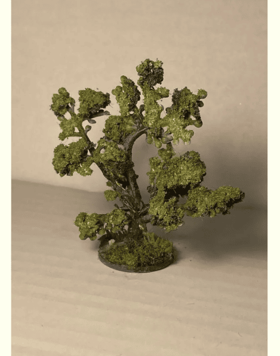
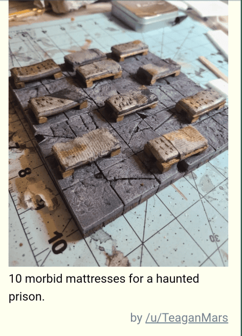
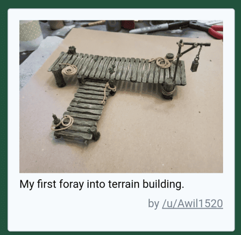
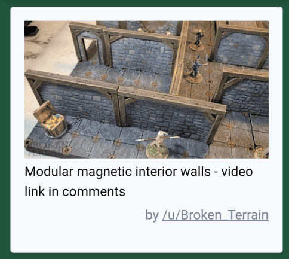

I've been going through old screenshots from 2022, looking at terrain and craft ideas that inspired me at the time. These are quick notes on techniques I wanted to try for my own projects.

<!-- Image 1 -->

Someone managed to transform a cheap plastic toy tree into something that actually works at the table. The base material was incredibly simple, but adding texture and paint made it look usable. I tried following this approach for my own trees.

<!-- Image 2 -->

I needed beds or sleeping mats for a scenario and found this example helpful. With just some foam, paint, and bits of wood, they put together something that worked pretty well. It seemed quick enough to replicate.

<!-- Image 3 -->

This is a wooden walkway. My players were going to cross a swamp, and I thought I could try something similar. The materials didn't look too complicated.

<!-- Image 4 -->

I've been thinking about walls. They add realism but make it hard to see the miniatures. This one appeared to use magnets to position the walls, so I wanted to dig into whether that system would actually be useful.
