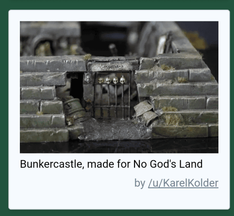
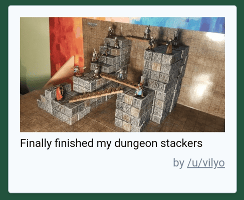
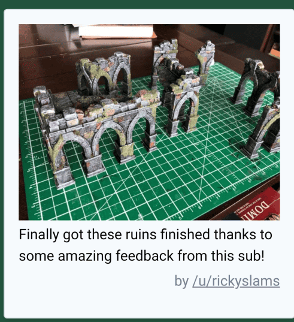
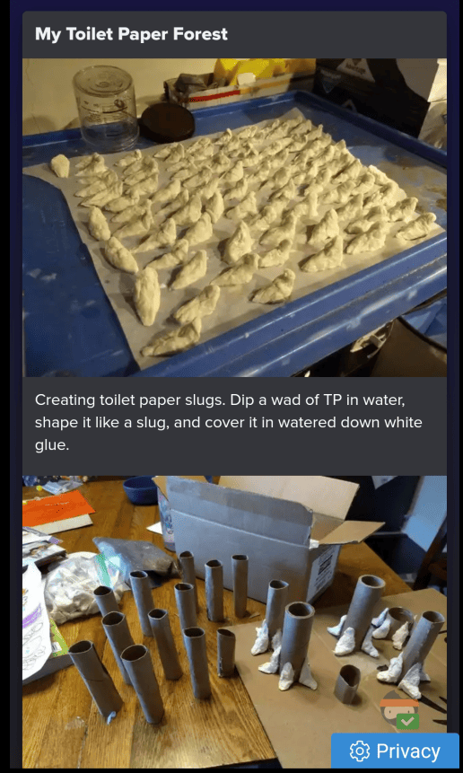
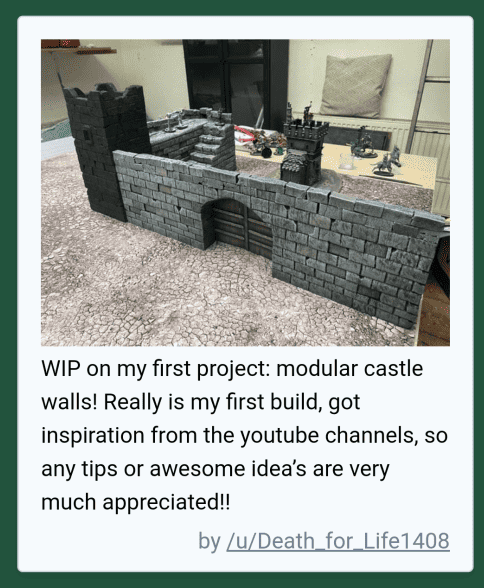

A collection of crafting ideas that caught my attention in February 2022, continuing from [January's terrain inspirations](/posts/inspirations/2022-01/). I was working on various terrain pieces and asking myself how to paint different color schemes and approach different construction techniques.

<!-- Image 1 -->

What interested me here was the way the stone was painted. It's really simple gray with what appears to be a lighter gray highlight on the edges. It's harder to see but there also seems to be a bit of variation on the bottom of the different bricks, painted a bit darker. What I also found interesting was the pyramid effect. It's actually made by gluing vertically different strips of decreasing size, which I found clever.

<!-- Image 2 -->

What impressed me here was the modularity of the stackers. These are elements that can serve as stairs, fit into each other, and allow for modularity both vertically and horizontally. I thought it would be nice if I could make some.

<!-- Image 3 -->

It's the color scheme that interested me. I can build this but how do I paint it? Here I see that from time to time a brick is painted a different color to give a bit of diversity, though I thought the orange was perhaps a bit too visible.

<!-- Image 4 -->

Here you see someone making tons of scenery in huge batches to create gigantic trees. That inspired me because I realized that to symbolize trees on a game board you don't need to make the canopy with all the branches. Just huge trunks let us realize the immensity of the tree and provide what we need mechanically: a place to take cover.

<!-- Image 5 -->

What I found interesting here was that they made their wall with very large bricks that render well. They're not sculpted but just stacked on top of each other, and they don't all have exactly the same depth, which gives this effect where some bricks are a bit more recessed than others. Using different bricks really gives this depth variation that you don't have when you sculpt. I'll reserve sculpting for horizontal surfaces but for vertical walls it's probably much better to stack individual bricks. Here they used very large bricks but just by offsetting them a little and making taller bricks at the top and thinner ones at the bottom it gives a good effect.

These were mostly questions I was working through in February about painting techniques and construction methods. Some of these ideas stuck with me, particularly the approach to vertical surfaces and the realization that simplification can be more effective than trying to capture every detail.

